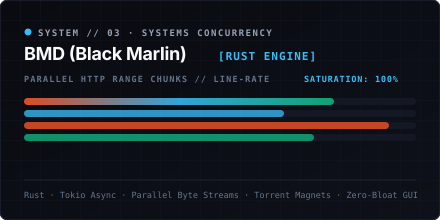

<div align="center">

  <!-- HUD STATUS BADGE -->
  <p align="center">
    <code>● SYSTEM NODE: DECOY-OS // REVISION 3.0.0-PROD // REGION: IN-NORTH-1 // RUNTIME: DETERMINISTIC</code>
  </p>

  <!-- CINEMATIC HERO -->
  <a href="#-executive-dispatch">
    
  </a>

  <br />

  <!-- EXECUTIVE METRIC PILLS -->
  <p align="center">
    <a href="https://github.com/DecoyINDIA"></a>
    &nbsp;
    <a href="#-architectural-pillars"></a>
    &nbsp;
    <a href="#-flagship-engineering-projects"></a>
    &nbsp;
    <a href="#-direct-connect--communication-console"></a>
  </p>

  <!-- QUICK NAVIGATION CONSOLE -->
  <p align="center">
    <a href="#-executive-dispatch"><code>DISPATCH</code></a> &bull;
    <a href="#-architectural-pillars"><code>PILLARS</code></a> &bull;
    <a href="#-flagship-engineering-projects"><code>PROJECTS</code></a> &bull;
    <a href="#-open-source-radar--developer-tooling"><code>OPEN SOURCE</code></a> &bull;
    <a href="#-technology-ecosystem"><code>ECOSYSTEM</code></a> &bull;
    <a href="#-telemetry--verified-metrics"><code>TELEMETRY</code></a> &bull;
    <a href="#-engineering-philosophy--core-tenets"><code>PHILOSOPHY</code></a> &bull;
    <a href="#-direct-connect--communication-console"><code>CONSOLE</code></a>
  </p>

</div>

---

<a id="-executive-dispatch"></a>
## ⚡ Executive Dispatch

> **"We engineer software as deterministic instruments. In an industry overwhelmed by brittle abstractions, cloud sprawl, and telemetry spyware, our mission is unequivocal: bare-metal execution speed, sovereign local-first privacy, and resilient agentic intelligence that respects human cognition."**

I am an engineering architect, systems builder, and founder at **XolverLabs**, operating from India for the global sovereign software ecosystem. My work investigates the boundary between bare-metal systems engineering and autonomous cognitive computing.

Modern web and enterprise architectures have normalized massive memory footprints, non-deterministic latency spikes, and invasive data harvesting. My engineering practice builds the explicit counter-model:
- **Local-first runtimes** that enforce zero outbound egress and run air-gapped on bare metal.
- **High-throughput concurrency pipelines** in **Rust** and **Java 21 (Loom)** that saturate line-rate hardware bandwidth.
- **Multilingual agentic architectures** that converse fluently in native Indian vernaculars without hallucinations.
- **Cryptographic dual-consent ledgers** that eliminate institutional asymmetry in metropolitan tenancy and property registries.

```text
┌─────────────────────────┬────────────────────────────────────────────────────────┐
│ ARCHITECTURAL CO-ORDINATE│ VALUE & VERIFIED SPECIFICATION                         │
├─────────────────────────┼────────────────────────────────────────────────────────┤
│ IDENTITY & HANDLE       │ Subham Jena (DecoyINDIA)                               │
│ PRIMARY AFFILIATION     │ Founder & Lead Architect // XolverLabs                 │
│ CORE SPECIALIZATIONS    │ Low-Latency Concurrency · Agentic AI · Sovereign Trust │
│ PRIMARY TOOLCHAINS      │ Rust · Java 21 (Virtual Threads) · Python · TypeScript │
│ INTERFACE ENGINEERING   │ TypeScript · React/Next.js · LivelyUI · Dark Obsidian  │
│ OPERATIONAL INVARIANT   │ Zero Bloat · Deterministic Latencies · Local-First     │
│ ACTIVE RESEARCH LAB     │ High-Throughput Packet Engines · Grounded Indic Speech │
└─────────────────────────┴────────────────────────────────────────────────────────┘
```

<div align="center">
  
</div>

<a id="-architectural-pillars"></a>
## 🏛️ Architectural Pillars

Four foundational disciplines govern every system engineered across our laboratories:

<table>
  <tr>
    <td width="50%" valign="top">
      <h3>⚡ 01 // Low-Latency & Systems Concurrency</h3>
      <p>
        Building bare-metal, memory-disciplined engines in <b>Rust</b> and <b>Java 21+</b> (Project Loom virtual threads). Eliminating garbage collection jitter, orchestrating non-blocking asynchronous event loops, and engineering lock-free circular ring buffers capable of saturating line-rate multi-threaded downloads and high-throughput document parsing.
      </p>
      <ul>
        <li><b>Core Primitives:</b> Tokio Async, Chunked Stream Allocation, Java NIO Channels, Zero-Copy Sockets.</li>
        <li><b>Latency Profile:</b> Predictable tail-latencies (p99 &lt; 15ms), zero unnecessary heap allocation, cache-line aligned structures.</li>
      </ul>
    </td>
    <td width="50%" valign="top">
      <h3>🤖 02 // Agentic AI & Vernacular Voice</h3>
      <p>
        Orchestrating stateful, multi-agent conversational directed acyclic graphs (DAGs) with <b>LangGraph</b> and <b>FastAPI</b>. Grounding generative LLMs with strict taxonomy gates, tenant-filtered Atlas vector indexes, and discrete token matching. Delivering real-time conversational front desks in native Indic tongues with absolute zero tolerance for hallucinations.
      </p>
      <ul>
        <li><b>Core Primitives:</b> Dual Scope Gates, Grounded RAG Retrieval, Real-time SIP/STT/TTS bridges.</li>
        <li><b>Dialects Supported:</b> Native Hindi, Odia, Hinglish, and English with sub-3s end-to-end voice dispatch.</li>
      </ul>
    </td>
  </tr>
  <tr>
    <td width="50%" valign="top">
      <h3>🛡️ 03 // Sovereign Data & Trust Ledgers</h3>
      <p>
        Designing software architectures for total institutional and individual sovereignty. Architecting air-gapped zero-egress runtimes that execute on-premise without tracking pixels, paired with immutable dual-consent cryptographic ledgers for rental agreements, legal discovery, and deposit escrows.
      </p>
      <ul>
        <li><b>Core Primitives:</b> Cryptographic Signatures, DPDP Act 2025 Compliance, Immutable Audit Hashes.</li>
        <li><b>Operational Standard:</b> Zero outbound telemetry, read-only root containers, fail-closed contracts.</li>
      </ul>
    </td>
    <td width="50%" valign="top">
      <h3>🎨 04 // High-Craft Interfaces & Kinetic Micro-UX</h3>
      <p>
        Treating user interface as an engineering discipline rather than superficial decoration. Drawing from the tactile design language of Apple, Vercel, and Linear: fluid physics springs (LivelyUI), dark-obsidian canvases, kinetic data telemetry, and responsive typography that feels alive under fingertip or mouse.
      </p>
      <ul>
        <li><b>Core Primitives:</b> LivelyUI Spring Dynamics, Custom SVG Animations, Kinetic CSS, Lenis Inertial Flow.</li>
        <li><b>Visual Standard:</b> 60fps rendering, tactile micro-feedback, high-density telemetry readability.</li>
      </ul>
    </td>
  </tr>
</table>

<div align="center">
  
</div>

<a id="-flagship-engineering-projects"></a>
## 🚀 Flagship Engineering Projects

A curated showcase of production platforms, developer runtimes, and open-source infrastructure.

<!-- ROW 1: OctaPDF & Vaani -->
<table width="100%">
  <tr>
    <td width="50%" valign="top">
      <a href="https://github.com/DecoyINDIA/OctaPDF">
        
      </a>
      <br />
      <h3><a href="https://github.com/DecoyINDIA/OctaPDF">OctaPDF</a></h3>
      <p>
        <a href="https://github.com/DecoyINDIA/OctaPDF/releases"></a>
        <a href="https://github.com/DecoyINDIA/OctaPDF/blob/main/LICENSE"></a>
      </p>
      <p><b>High-Performance Local-First Document Workspace & Zero-Egress Engine</b></p>
      <p>
        A calm, air-gapped document workspace engineered in Java 21+ for reading, splitting, annotating, redacting, and converting high-volume PDF files. Built on the <i>Paper Desk</i> design system with 50+ Command Palette tools and absolute privacy guarantees.
      </p>
      <ul>
        <li><b>Zero Egress Architecture:</b> Permanent removal of third-party tracking pixels; containers operate with read-only root filesystems and internal network isolation (<code>internal: true</code>), completely blocking WAN leakage.</li>
        <li><b>Universal Intake Deck:</b> Instant page breakout into interactive vector thumbnails with sub-12ms page rendering latency.</li>
        <li><b>Single-Pass Pipelines:</b> Chain multi-step redactions, rotations, and cleanups into atomic batch executions via GUI, API, or CLI.</li>
      </ul>
      <p>
        <code>Java 21</code> · <code>XolverLabs</code> · <code>Project Loom</code> · <code>Zero-Egress</code> · <code>Docker</code>
      </p>
      <p>
        <a href="https://github.com/DecoyINDIA/OctaPDF"><b>Explore OctaPDF Repository →</b></a>
      </p>
    </td>
    <td width="50%" valign="top">
      <a href="https://github.com/DecoyINDIA/vaani">
        
      </a>
      <br />
      <h3><a href="https://github.com/DecoyINDIA/vaani">Vaani</a></h3>
      <p>
        <a href="https://github.com/DecoyINDIA/vaani"></a>
        <a href="https://github.com/DecoyINDIA/vaani"></a>
      </p>
      <p><b>Vernacular AI Front Desk & Autonomous Voice/WhatsApp Booking Employee</b></p>
      <p>
        The autonomous front office employee for Indian SMBs (clinics, salons, diagnostic labs, tuition institutes). Resolves incoming WhatsApp interactions and telephony calls in native Indic tongues with atomic calendar conflict prevention.
      </p>
      <ul>
        <li><b>Multilingual Reception:</b> Fluent conversation in Hindi, Odia, Hinglish, and English with sub-3s response latencies.</li>
        <li><b>0-Hallucination Scope Gates:</b> Dual-scope LangGraph routing paired with discrete token grounding against verified tenant business facts.</li>
        <li><b>Atomic Booking Engine:</b> Validated against 500-concurrent-claim race conditions on MongoDB replica sets; zero double-booking guarantee.</li>
      </ul>
      <p>
        <code>Python 3.12</code> · <code>LangGraph</code> · <code>FastAPI</code> · <code>MongoDB Replica</code> · <code>Redis</code> · <code>DPDP Act</code>
      </p>
      <p>
        <a href="https://github.com/DecoyINDIA/vaani"><b>Explore Vaani Repository →</b></a>
      </p>
    </td>
  </tr>
</table>

<!-- ROW 2: Settlr & SportsHawk -->
<table width="100%">
  <tr>
    <td width="50%" valign="top">
      <a href="https://github.com/DecoyINDIA/Settlr">
        
      </a>
      <br />
      <h3><a href="https://github.com/DecoyINDIA/Settlr">Settlr</a></h3>
      <p>
        
        
      </p>
      <p><b>Ownership-Gated Rental Trust Platform with Cryptographic Dual-Consent Ledger</b></p>
      <p>
        A transformative trust infrastructure for metropolitan tenancy markets. Eliminates arbitrary security deposit deductions, fake broker inventory, and tenant-landlord friction through title-verified listings and dual-consent escrow milestones.
      </p>
      <ul>
        <li><b>Ownership-Gated Registry:</b> Direct municipal registry cross-checks ensure only authentic property owners can list assets, neutralizing broker ghost listings.</li>
        <li><b>Dual-Consent Escrow Ledger:</b> Security deposit releases and deduction claims require cryptographic co-signatures backed by photographic intake and exit inspection hashes.</li>
        <li><b>Delhi Cluster Rollout:</b> Targeted deployment solving structural rental asymmetry across the National Capital Region.</li>
      </ul>
      <p>
        <code>Python</code> · <code>FastAPI</code> · <code>PostgreSQL</code> · <code>Cryptographic Signatures</code> · <code>Escrow Protocol</code>
      </p>
      <p>
        <a href="https://github.com/DecoyINDIA/Settlr"><b>Inspect Settlr System Architecture →</b></a>
      </p>
    </td>
    <td width="50%" valign="top">
      <a href="https://github.com/DecoyINDIA/SportsHawk">
        
      </a>
      <br />
      <h3><a href="https://github.com/DecoyINDIA/SportsHawk">SportsHawk</a></h3>
      <p>
        
        
      </p>
      <p><b>AI-Powered Grassroots Football Development Platform with Computer Vision Scoring</b></p>
      <p>
        Democratizing athletic talent development across India. Allows young footballers to record agility drills with any budget smartphone, receive instant on-device computer vision performance scoring, and generate verified Player Cards for scout discovery.
      </p>
      <ul>
        <li><b>Edge Computer Vision:</b> 100% on-device kinematic tracking of ball velocity, cone drills, and footwork cadence without cloud GPU overhead.</li>
        <li><b>Grassroots Accessibility:</b> Zero subscription fees, zero advertising bloat, and full native localization across 9 Indian languages.</li>
        <li><b>Academy Management:</b> Complete administrative toolsets for grassroots coaches to organize tournament brackets, monitor player stamina curves, and verify rosters.</li>
      </ul>
      <p>
        <code>JavaScript</code> · <code>Edge Computer Vision</code> · <code>MediaPipe / TensorFlow.js</code> · <code>PWA</code> · <code>Public Good</code>
      </p>
      <p>
        <a href="https://github.com/DecoyINDIA/SportsHawk"><b>Inspect SportsHawk Architecture →</b></a>
      </p>
    </td>
  </tr>
</table>

<!-- ROW 3: BMD & Formspear -->
<table width="100%">
  <tr>
    <td width="50%" valign="top">
      <a href="https://github.com/DecoyINDIA/BMD">
        
      </a>
      <br />
      <h3><a href="https://github.com/DecoyINDIA/BMD">BMD (Black Marlin Downloader)</a></h3>
      <p>
        <a href="https://github.com/DecoyINDIA/BMD/releases"></a>
        <a href="https://github.com/DecoyINDIA/BMD"></a>
      </p>
      <p><b>High-Throughput Multi-Threaded Chunked Download Manager for Desktop</b></p>
      <p>
        A blazing fast, native download acceleration engine written in Rust for Windows, Linux, and macOS. Saturates line-rate throughput via segmented byte streams with resilient resuming, browser extension dispatch, and torrent magnet ingestion.
      </p>
      <ul>
        <li><b>Dynamic Byte Chunking:</b> Parallel HTTP Range chunk allocation maximizes bandwidth utilization across unstable international backbones.</li>
        <li><b>Deterministic State Journal:</b> Crash-resilient binary state logging allows instantaneous resumption of terabyte-scale payloads without file re-verification.</li>
        <li><b>Zero-Bloat Native UI:</b> Crafted with clean native styling, background queue scheduling, and dynamic QoS speed throttling.</li>
      </ul>
      <p>
        <code>Rust</code> · <code>Tokio</code> · <code>Multi-Threading</code> · <code>BitTorrent</code> · <code>Browser Native Messaging</code>
      </p>
      <p>
        <a href="https://github.com/DecoyINDIA/BMD"><b>Explore BMD Repository & Releases →</b></a>
      </p>
    </td>
    <td width="50%" valign="top">
      <a href="https://github.com/DecoyINDIA/Formspear">
        
      </a>
      <br />
      <h3><a href="https://github.com/DecoyINDIA/Formspear">Formspear</a></h3>
      <p>
        <a href="https://github.com/DecoyINDIA/Formspear"></a>
        <a href="https://github.com/DecoyINDIA/Formspear"></a>
      </p>
      <p><b>Full-Stack Reactive Forms, Enterprise Surveys, Real-Time Analytics & AI Insights OS</b></p>
      <p>
        A battle-hardened feedback and telemetry platform built on an enterprise 39-table relational PostgreSQL schema baseline with 13 optimized indexes, real-time NPS tracking, BullMQ job queues, and fail-closed security contracts.
      </p>
      <ul>
        <li><b>Relational Rigor:</b> Strict SQL schema managing conditional logic trees, respondent session tokens, quota enforcement, and signed webhooks.</li>
        <li><b>LLM Insight Synthesis:</b> Background worker jobs aggregate unstructured verbatim feedback into theme clusters, sentiment scores, and executive summaries.</li>
        <li><b>Independent Undo/Redo Engine:</b> Full-fidelity client-side builder runtime with deep revision stacks and zero-dependency embed SDKs.</li>
      </ul>
      <p>
        <code>Node.js</code> · <code>PostgreSQL</code> · <code>BullMQ</code> · <code>Redis</code> · <code>AI Summaries</code> · <code>Stripe / Razorpay</code>
      </p>
      <p>
        <a href="https://github.com/DecoyINDIA/Formspear"><b>Explore Formspear Repository →</b></a>
      </p>
    </td>
  </tr>
</table>

<div align="center">
  
</div>

<a id="-open-source-radar--developer-tooling"></a>
### 🛰️ Open Source Radar & Developer Tooling

Specialized tools, agent skills, and creative experiments engineered for the software craft community:

- **[AI-Websites-Cloner](https://github.com/DecoyINDIA/AI-Websites-Cloner)** — *Automated full-stack website cloning engine.* Orchestrates AI coding agents to inspect, extract assets, decompose layout logic, and reproduce complete modern web interfaces with clean containerized codebases.
- **[AI_Jantra](https://github.com/DecoyINDIA/AI_Jantra)** — *Agentic AI execution harness.* A deterministic toolchain engineered for autonomous agent reasoning, structured scratchpad reflection, and automated task execution.
- **[LivelyUI](https://github.com/DecoyINDIA/LivelyUI)** — *Micro-interaction and physics design skill.* Translates the foundational principles of "Details that make interfaces feel better" into reusable spring dynamic curves, tactile feedback patterns, and kinetic UI transitions.
- **[iADHD](https://github.com/DecoyINDIA/iADHD)** — *High-signal cognitive adapter for AI coding agents.* Enforces conversational discipline by stripping conversational preamble and formatting responses into immediate bottom-line actionables and code diffs.
- **[candy-drop](https://github.com/DecoyINDIA/candy-drop)** — *High-frame-rate browser arcade game.* Engineered with clean Canvas 2D rendering, zero dependencies, spatial collision physics, and kinetic combo particle effects.

<div align="center">
  
</div>

<a id="-technology-ecosystem"></a>
## 🧬 Technology Ecosystem

A cohesive technical matrix spanning low-level system runtimes, distributed cloud services, and agentic intelligence frameworks:

<div align="center">
  
</div>

<br />

| Layer | Technologies & Frameworks | Architectural Competencies |
| :--- | :--- | :--- |
| **⚡ Systems & Runtimes** | `Rust` · `Java 21 (Loom)` · `C/C++` · `Go` | Multi-threaded packet handling, memory-mapped I/O, zero-egress sandboxing, lock-free queues, native platform bindings. |
| **🤖 AI & Agentic Orchestration** | `LangGraph` · `Python 3.12` · `FastAPI` · `PyTorch` · `Whisper / Kokoro` | Multi-agent state machines, discrete token grounding, RAG with tenant-filtered vector indexes, Indic speech synthesis. |
| **🎨 Interface & Interaction** | `TypeScript` · `Next.js` · `Tailwind CSS` · `Canvas 2D` · `WebSockets` | Fluid spring physics (LivelyUI), tactile micro-interactions, dark-mode native styling, sub-frame input responsiveness. |
| **🗄️ Persistence & Infrastructure** | `PostgreSQL (Strict Relational)` · `MongoDB 7+ (Replica)` · `Redis` · `BullMQ` · `Docker` | Atomic multi-document transactions, advisory locks, 39-table schema migrations, background worker pipelines, CI hardening. |

<div align="center">
  
</div>

<a id="-telemetry--verified-metrics"></a>
## 📊 Telemetry & Verified Metrics

Real-time telemetry and developer cadence across GitHub infrastructure:

<div align="center">
  
  &nbsp;&nbsp;
  
  <br /><br />
  
</div>

<div align="center">
  
</div>

<a id="-engineering-philosophy--core-tenets"></a>
## ⚖️ Engineering Philosophy & Core Tenets

```
 01. DETERMINISTIC ARCHITECTURE OVER NOVELTY
     Every software system must have well-defined latency boundaries, predictable state machines,
     and fail-closed invariants. Code that cannot be reasoned about under failure is broken by definition.

 02. SOVEREIGNTY BY DESIGN (ZERO EGRESS)
     User data belongs exclusively to the user. Default to local-first execution. Containers must run
     read-only roots with egress firewalls. Telemetry pixels and third-party phone-home calls are toxic.

 03. VERNACULAR-FIRST HUMAN ALIGNMENT
     Technology in the Global South cannot exist solely behind English academic walls. High-technology
     must answer in Hindi, Odia, and regional tongues with zero hallucination and radical respect for human intent.

 04. KINETIC CRAFT AS FUNCTIONAL CLARITY
     Interfaces are not superficial varnish; they are the contract between human cognition and machine logic.
     Spring physics, intentional contrast, and micro-feedback reduce user error and dignify everyday labor.
```

<div align="center">
  
</div>

<a id="-direct-connect--communication-console"></a>
## 📡 Direct Connect & Communication Console

Open for technical architectural consultations, high-performance systems engineering, and strategic enterprise pilots:

```text
┌────────────────────────────────────────────────────────────────────────────────────────┐
│ DECOY // DIRECT TRANSMISSION CHANNELS                                                  │
├─────────────────────┬──────────────────────────────────────────────────────────────────┤
│ PRIMARY STUDIO      │ XolverLabs (https://xolver.com)                                  │
│ DIRECT INBOX        │ lawflow.india@gmail.com                                          │
│ FOUNDER DIRECT      │ subhamjena.j@gmail.com                                           │
│ GITHUB PROTOCOL     │ https://github.com/DecoyINDIA                                    │
│ NETWORK STATUS      │ Available for Agentic AI Architecture, Rust/Java Low-Latency R&D │
└─────────────────────┴──────────────────────────────────────────────────────────────────┘
```

<br />

<div align="center">
  <a href="mailto:lawflow.india@gmail.com"></a>
  &nbsp;&nbsp;
  <a href="https://github.com/DecoyINDIA"></a>
  &nbsp;&nbsp;
  <a href="https://github.com/DecoyINDIA/OctaPDF"></a>
</div>

<br />

<div align="center">
  <a href="#-executive-dispatch">
    
  </a>
</div>
