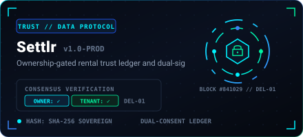

  

Hi, I'm Subham. I write software from Bhubaneswar, Odisha.

Most of what I build is for people the usual tech skips over: the clinic that can't pick up the phone after 7pm, the advocate who still tracks hearing dates in a diary, the kid in a small town who's good at football and has no way for a scout to ever find out.

I run a small studio called [XolverLabs](https://xolver.in), and that's where most of these projects live.

A few things I keep coming back to:

- Your files should stay on your machine unless you decide otherwise.
- If something is built for India, it should work in Hindi and Odia, not just English.
- An assistant that says "I'm not sure, let me get someone" beats one that makes things up.
- How a page loads, how a button feels: the small stuff matters more than people admit.

 

## What I'm building

Small clinics and salons lose a lot of business to missed calls. Vaani answers the phone and WhatsApp, books the slot, and hands off to a real person when it's out of its depth. When it doesn't know something, it says so instead of guessing. I threw 500 simultaneous requests for the same slot at the booking engine, and it never double-booked.

I got tired of uploading contracts to random websites just to merge two PDFs. OctaPDF started as a fork of [Stirling-PDF](https://github.com/Stirling-Tools/Stirling-PDF), and I've been reshaping it into something calmer: keyboard-first (⌘K gets you anywhere), no tracking, and nothing leaves your computer.

My excuse to write a lot of Rust. Black Marlin splits a download into parallel chunks, survives crashes without starting over, takes magnet links, and has a browser extension that hands downloads straight to it.

Forms, surveys, NPS, and alerts when someone leaves an angry review. I built it on plain `node:http` with no framework, mostly to see how far that could go. It went further than I expected.

Anyone who has rented in Delhi knows about fake listings and deposits that never come back. Settlr only lists homes where ownership has been checked, and any change to rent or the deposit has to be signed by both tenant and owner. Starting with a pilot in South Delhi.

Kids record a drill on whatever phone they have, and the scoring runs on the phone itself, so the video never gets uploaded anywhere. No fees, no ads, nine languages planned. English and Hindi work today.

Built with advocates' actual days in mind: a desktop app in chambers, a phone app that works offline in court corridors, and a client portal that only shows each client their own case.

 

## Smaller things and experiments

- **[XenAlgo](https://github.com/DecoyINDIA/XenAlgo)**: a swing-trading bot for the NSE. Every order goes through a risk check first, and the portfolio only changes when the broker confirms a fill.
- **[candy-drop](https://github.com/DecoyINDIA/candy-drop)**: browser arcade games written in plain Canvas and Web Audio. No libraries, no build step, and it works offline.
- **[Speak-It](https://github.com/DecoyINDIA/Speak-It)**: hold <kbd>Ctrl</kbd> + <kbd>Win</kbd> and talk, and it types for you anywhere in Windows. It understands Hinglish and falls back to offline Whisper.
- **[SantianoFX](https://github.com/DecoyINDIA/SantianoFX)**: an After Effects panel for easing curves, speed ramps and camera shake.
- **[AI_Jantra](https://github.com/DecoyINDIA/AI_Jantra)**: turns a product idea into specs, and throws out any claim it can't trace back to a source.
- **[EventX](https://github.com/DecoyINDIA/EventX)**: a small engine for reminders tied to dates, like birthdays, renewals and anniversaries.
- **[FireBNB](https://github.com/DecoyINDIA/FireBNB)**: a Flutter app for finding hotel deals.
- **[AI-Websites-Cloner](https://github.com/DecoyINDIA/AI-Websites-Cloner)**: point it at a website and get a Next.js codebase back.

 

## Tools I reach for

Rust, Java, Python and TypeScript. Postgres for almost everything. Next.js, Flutter, Expo and Tauri for the parts people touch. Docker to ship it.

 

## On GitHub

Redrawn every morning by a small script in this repo, from my real activity.

 

## Say hello

If you're working on something in the same space, or you just want to talk shop, email me at [subhamjena.j@gmail.com](mailto:subhamjena.j@gmail.com).

The wheel at the top is from the Sun Temple at Konark, about an hour's drive from home. It's also a working sundial, which is why there's a shadow moving across it.

  

