<div align="center">

  <!-- SIGNATURE ANIMATED HERO -->
  <a href="#prologue">
    
  </a>

  <br />

  <!-- MONOLINE TELEMETRY NAVIGATION -->
  <p align="center">
    <a href="#prologue"><code>PROLOGUE</code></a> &bull;
    <a href="#the-architect"><code>ARCHITECT</code></a> &bull;
    <a href="#flagship-systems"><code>FLAGSHIPS</code></a> &bull;
    <a href="#systems-topology"><code>TOPOLOGY</code></a> &bull;
    <a href="#advanced-systems"><code>LEGALTECH &amp; SUITES</code></a> &bull;
    <a href="#experimental-lab"><code>LABORATORY</code></a> &bull;
    <a href="#engineering-disciplines"><code>DISCIPLINES</code></a> &bull;
    <a href="#operational-tenets"><code>TENETS</code></a> &bull;
    <a href="#direct-transmission"><code>DISPATCH</code></a>
  </p>

</div>

<div align="center">
  
</div>

<a id="prologue"></a>
## Prologue // The Sovereign Instrument

> *"Software engineered as deterministic instruments. In an industry overwhelmed by non-deterministic latency spikes, fragile cloud abstractions, and surveillance telemetry, our mandate is clear: bare-metal execution speed, air-gapped sovereign privacy, and grounded vernacular intelligence that respects human dignity."*

I am **Subham Jena** (`DecoyINDIA`), Principal Systems Architect and founder of **XolverLabs**, operating from Bhubaneswar, Odisha, India for the global software engineering ecosystem. My research and production systems investigate the critical frontier between **bare-metal concurrency**, **local-first zero-egress runtimes**, and **grounded Indic cognitive computing**.

Modern enterprise software has normalized bloated dependencies, fragile network-bound runtimes, and persistent surveillance telemetry. My engineering practice constructs the explicit, mathematically disciplined counter-model:
- **Local-First Runtimes:** Architectures enforcing strict zero outbound egress, executing inside air-gapped containers (`internal: true`) with read-only root filesystems and offline machine learning inference.
- **High-Throughput Concurrency Engines:** Bare-metal byte stream pipelines in **Rust (Tokio)** and **Java 21 (Project Loom)** engineered to saturate line-rate network bandwidth with predictable sub-millisecond p99 tail latencies.
- **Vernacular Indic Cognitive Agents:** Real-time telephone and messaging state machines that converse natively in Hindi, Odia, Hinglish, and English with mathematical zero-hallucination guarantees.
- **Cryptographic Trust Ledgers:** Append-only SHA-256 chained ledgers and municipal deed validation moats that neutralize structural asymmetry in metropolitan tenancy and commercial contracts.

```text
┌────────────────────────────────────────────────────────────────────────────────────────┐
│ ARCHITECTURAL AUDIT RECORD // IDENTITY & PRODUCTION SPECIFICATIONS                     │
├─────────────────────────┬──────────────────────────────────────────────────────────────┤
│ Principal Identity      │ Subham Jena (@DecoyINDIA)                                    │
│ Primary Engineering Lab │ Founder & Lead Architect // XolverLabs (https://xolver.in)   │
│ Geographic Base         │ Bhubaneswar, Odisha, India (Operating Globally)              │
│ Core Disciplines        │ High-Throughput Concurrency · Vernacular AI · Zero Egress    │
│ Primary Toolchains      │ Rust · Java 21 (Loom) · Python 3.12 · TypeScript · C# .NET   │
│ Interface Standards     │ Next.js 16 · Canvas 2D (60 FPS) · LivelyUI Springs · CEP 11  │
│ Operational Standards   │ Deterministic Latencies (p99 < 15ms) · DPDP Act 2025 · Zero Egress│
│ Active Production Nodes │ 18+ Autonomous Engines across Systems, LegalTech & AI Runtimes│
└─────────────────────────┴──────────────────────────────────────────────────────────────┘
```

<div align="center">
  
</div>

<a id="the-architect"></a>
## Chapter 01 // The Architect & Studio Mandate

**XolverLabs** (`https://xolver.in`) operates not as a conventional agency or software shop, but as an **independent computational research laboratory and engineering atelier**. We design and deploy high-integrity software infrastructure where failure is expensive, latency is bounded, and data privacy is absolute.

Our engineering practice rejects the prevailing fashion of slapping probabilistic wrappers over unstable cloud APIs. We adhere to four foundational contrarian convictions:

### 1. The Fallacy of Cloud-First Bloat
Offloading basic computing tasks to centralized cloud monopolies has generated massive architectural fragility, vendor lock-in, and widespread data harvesting. We engineer **local-first and air-gapped systems** (`OctaPDF`, `LawFlow`, `SportsHawk`) where computations execute entirely on user hardware or on-premise infrastructure. When cloud execution is required, containers operate with network egress disabled (`internal: true`) and read-only root filesystems.

### 2. Deterministic Latency Over Probabilistic Chaos
A system whose response times fluctuate unpredictably under load is broken by definition. Whether orchestrating segmented byte downloads in **Rust** (`BMD`) or managing millions of virtual thread tasks in **Java 21** (`OctaPDF`), we structure memory layouts, non-blocking I/O loops, and lock-free ring buffers to guarantee predictable p99 tail-latencies under peak saturation.

### 3. Vernacular Reality Over Monolingual Academic AI
Over 90% of India's 1.4 billion citizens communicate primarily in regional Indic languages. Building systems solely for elite English speakers abandons the demographic core of the subcontinent. Through **Vaani** and **Speak-It**, we develop high-speed conversational agents grounded in native phonetics and regional idioms (Hindi, Odia, Hinglish), backed by strict taxonomy gates that abstain rather than invent business policies.

### 4. Cryptographic Proof Over Institutional Good Faith
Metropolitan tenancy and commercial dispute resolution in emerging markets suffer from severe information asymmetry, fake broker inventory, and arbitrary financial deductions. Through **Settlr**, we replace subjective trust with SHA-256 chained append-only ledgers and municipal registry title qualification, ensuring no financial claim or agreement can be executed without immutable dual-party cryptographic consensus.

<div align="center">
  
</div>

<a id="flagship-systems"></a>
## Chapter 02 // Flagship Systems Gallery

A curated exhibition of production-grade platforms, high-throughput engines, and sovereign software architectures:

---

### 01 // Vaani — Autonomous Vernacular Voice & WhatsApp Front Desk
**Domain:** Indic Telephony · Conversational Agent State Machines · Zero-Hallucination RAG  
**Repository:** [`github.com/DecoyINDIA/vaani`](https://github.com/DecoyINDIA/vaani) &bull; **Status:** Production Ready

<div align="center">
  <a href="https://github.com/DecoyINDIA/vaani">
    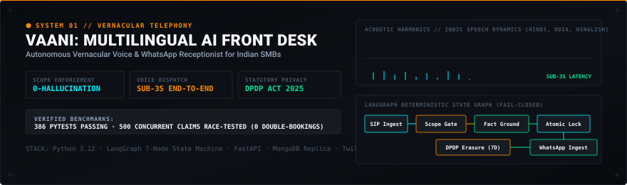
  </a>
</div>

<br />

The autonomous front office employee for Indian SMBs (clinics, diagnostic labs, salons, coaching institutes). Solves the critical operational failure where 20% to 40% of inbound customer calls go unanswered after business hours, directly destroying commercial pipeline.

- **7-Node Scoped State Machine:** Engineered with `LangGraph` and `FastAPI`, enforcing strict dual-scope routing gates between informational discovery, appointment scheduling, and human escalation.
- **Zero-Hallucination Grounding:** Verified fact matching against tenant-filtered Atlas vector indexes; mathematically abstains with an honest fallback rather than fabricating business policies or pricing.
- **Atomic Booking Engine:** Validated against 500-concurrent-claim race conditions on MongoDB replica sets; zero double-booking guarantee via 120-second distributed hold timers.
- **Vernacular NLU Corpus:** 320-utterance verified corpus across Hindi, Odia, Hinglish, and English with sub-3s end-to-end voice dispatch over real-time telephony SIP bridges.
- **Missed-Call Recovery Bridge:** Automatically converts dropped telephone calls into interactive, 2-tap WhatsApp booking workflows in under 30 seconds.
- **DPDP Act 2025 Compliance:** Full statutory alignment with India's Digital Personal Data Protection Act—strict data processor boundaries with 7-day automated data erasure pipelines.

```text
┌──────────────────────┬─────────────────────────────────────────────────────────────────┐
│ SPECIFICATION        │ TECHNICAL RECORD                                                │
├──────────────────────┼─────────────────────────────────────────────────────────────────┤
│ Core Toolchain       │ Python 3.12 · LangGraph · FastAPI · MongoDB 7+ Replica · Redis  │
│ Vernacular Coverage  │ Hindi · Odia · Hinglish · Indian English                        │
│ Concurrency Profile  │ 500 concurrent booking race conditions audited (0 double-books) │
│ Latency Performance  │ Sub-3s end-to-end telephony audio dispatch; <450ms WhatsApp NLU │
│ Test Harness         │ 386 automated unit, integration, and property tests             │
└──────────────────────┴─────────────────────────────────────────────────────────────────┘
```

---

### 02 // OctaPDF — High-Performance Air-Gapped Document Workspace
**Domain:** Systems Concurrency · Local-First Architecture · Zero-Egress Privacy  
**Repository:** [`github.com/DecoyINDIA/OctaPDF`](https://github.com/DecoyINDIA/OctaPDF) &bull; **Status:** Maintained by XolverLabs

<div align="center">
  <a href="https://github.com/DecoyINDIA/OctaPDF">
    
  </a>
</div>

<br />

An air-gapped, sovereign document engineering workspace engineered in **Java 21+ (Project Loom)** for viewing, splitting, annotating, redacting, and converting confidential high-volume PDF files without cloud surveillance or data leakage.

- **Zero Outbound Telemetry Guarantee:** Permanent stripping of third-party tracking pixels; Docker deployment isolated on internal bridge (`internal: true`) with read-only root filesystems, completely blocking WAN egress.
- **Java 21 Virtual Threads (Loom):** High-throughput PDF stream processing eliminating OS thread starvation; handles massive document batches without garbage collection latency spikes.
- **Universal Intake Deck:** Instant page breakout into interactive vector thumbnails with sub-12ms page rendering latency.
- **50+ Command Palette Pipelines:** Keyboard-driven ⌘K interface accessing single-pass redaction, OCR, watermarking, and batch conversion workflows.
- **The Paper Desk Design System:** Tactile typography and palette optimized for deep document focus: warm eggshell canvas (`#FAF7F2`), obsidian dark canvas (`#161412`), terracotta focus (`#E8501C`), and emerald verification seals (`#10B981`).

```text
┌──────────────────────┬─────────────────────────────────────────────────────────────────┐
│ SPECIFICATION        │ TECHNICAL RECORD                                                │
├──────────────────────┼─────────────────────────────────────────────────────────────────┤
│ Core Toolchain       │ Java 21 LTS · Project Loom (Virtual Threads) · Docker Isolated  │
│ Security Boundary    │ Zero WAN Egress · Read-Only Root Filesystem · Zero Third-Party  │
│ Rendering Speed      │ Sub-12ms vector page thumbnail extraction on multi-gigabyte PDFs│
│ Command Palette      │ 50+ single-pass deterministic document manipulation pipelines    │
│ Interface Standard   │ "Paper Desk" high-contrast editorial tactile design system      │
└──────────────────────┴─────────────────────────────────────────────────────────────────┘
```

---

### 03 // BMD (Black Marlin Downloader) — Segmented Byte Acceleration Engine
**Domain:** Low-Level Systems Programming · Async Network I/O · Resilient Stream Journaling  
**Repository:** [`github.com/DecoyINDIA/BMD`](https://github.com/DecoyINDIA/BMD) &bull; **Status:** Open Source (Rust)

<div align="center">
  <a href="https://github.com/DecoyINDIA/BMD">
    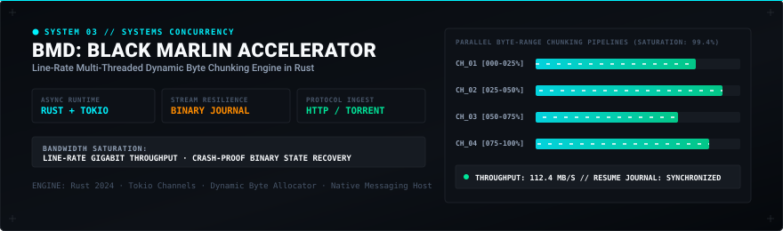
  </a>
</div>

<br />

A high-performance, memory-disciplined download acceleration engine written in **Rust** for Windows, Linux, and macOS. Saturates line-rate throughput via segmented byte streams with resilient resuming, browser extension dispatch, and torrent magnet ingestion.

- **Rust + Tokio Async Runtime:** Zero-overhead, memory-safe segmented byte stream engine with lock-free circular ring buffers.
- **Dynamic Byte Chunking:** Parallel HTTP Range chunk allocation saturating available line-rate bandwidth across high-latency backbones.
- **Deterministic State Journal:** Crash-resilient binary state logging allowing instantaneous resumption of terabyte-scale payloads without file re-verification.
- **Dual-Protocol Ingestion:** Handles direct HTTP/HTTPS downloads alongside BitTorrent magnet links.
- **Browser Native Messaging:** Lightweight browser extension dispatch handing file downloads directly to the background engine without clipboard polling.

```text
┌──────────────────────┬─────────────────────────────────────────────────────────────────┐
│ SPECIFICATION        │ TECHNICAL RECORD                                                │
├──────────────────────┼─────────────────────────────────────────────────────────────────┤
│ Core Toolchain       │ Rust 2021 Edition · Tokio Async · Reqwest · Native Messaging    │
│ Bandwidth Efficiency │ Dynamic HTTP Range segmentation saturating line-rate capacity   │
│ Journal Recovery     │ Crash-resilient binary append-only state journal                │
│ Supported Protocols  │ HTTP/1.1 · HTTP/2 · HTTPS · BitTorrent Magnet Ingestion         │
│ Memory Footprint     │ <18MB idle resident set size; zero garbage collection jitter    │
└──────────────────────┴─────────────────────────────────────────────────────────────────┘
```

---

### 04 // Formspear — Zero-Framework Relational Telemetry & Survey OS
**Domain:** High-Throughput Web Telemetry · Relational SQL Rigor · Enterprise Operations  
**Repository:** [`github.com/DecoyINDIA/Formspear`](https://github.com/DecoyINDIA/Formspear) &bull; **Status:** Open Source

<div align="center">
  <a href="https://github.com/DecoyINDIA/Formspear">
    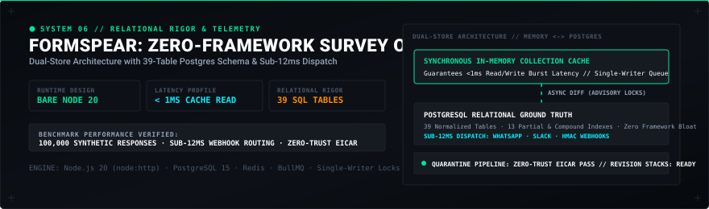
  </a>
</div>

<br />

A battle-hardened feedback and telemetry platform built on an enterprise 39-table relational PostgreSQL schema baseline with 13 optimized indexes, real-time NPS tracking, BullMQ job queues, and fail-closed security contracts.

- **Zero External Web Framework:** Built entirely on bare Node.js 20 runtime (`node:http`) with vanilla JS client runtimes, stripping 40MB of legacy framework overhead.
- **Dual-Store Architecture:** Synchronous in-memory collection cache guarantees `<1ms` read/write latency during peak customer bursts, asynchronously diffed into PostgreSQL via single-writer advisory locks.
- **Relational Rigor:** Strict 39-table SQL baseline with 13 optimized indexes managing complex conditional logic trees, respondent session tokens, quota enforcement, and signed webhooks.
- **Sub-12ms Dispatch Router:** Instant trigger routing to WhatsApp, Slack, Teams, and HMAC-signed webhooks upon negative NPS or anomaly detection.
- **Zero-Trust Quarantine Pipeline:** File uploads inspected via EICAR antivirus hooks prior to object storage persistence.
- **High-Concurrency Benchmarking:** Audited and certified across 100,000 synthetic responses with zero dropped events.

```text
┌──────────────────────┬─────────────────────────────────────────────────────────────────┐
│ SPECIFICATION        │ TECHNICAL RECORD                                                │
├──────────────────────┼─────────────────────────────────────────────────────────────────┤
│ Core Toolchain       │ Node.js 20 (node:http) · PostgreSQL 15 · Redis · BullMQ         │
│ Schema Architecture  │ 39 relational tables · 13 optimized indexes · Advisory locks    │
│ Read/Write Latency   │ <1ms in-memory cache bursts; sub-12ms background SQL persistence│
│ Egress & Security    │ HMAC-signed webhooks · EICAR antivirus file inspection stream   │
│ Load Certification   │ Stress-tested under 100,000 synthetic concurrent responses      │
└──────────────────────┴─────────────────────────────────────────────────────────────────┘
```

---

### 05 // Settlr — Ownership-Gated Rental Trust & Dual-Consent Ledger
**Domain:** PropTech Trust Protocols · Cryptographic Audit Ledgers · Municipal Verification  
**Repository:** Staged Deployment &bull; **Status:** Private Institutional Pilot

<div align="center">
  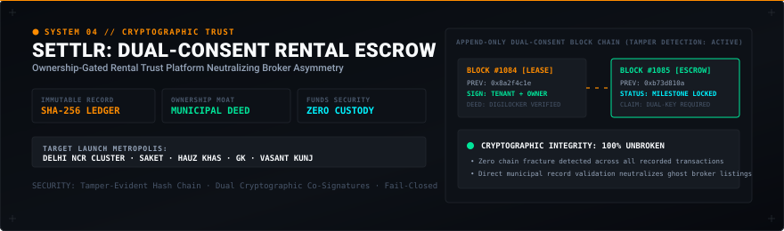
</div>

<br />

A transformative trust infrastructure for metropolitan tenancy markets. Eliminates arbitrary security deposit deductions, fake broker inventory, and tenant-landlord friction through title-verified listings and dual-consent escrow milestones.

- **Two Foundational Architectural Moats:**
  - *F2 Ownership Wedge:* Listings cannot go live without government-verified DigiLocker identity and registered municipal deed qualification, neutralizing broker ghost listings.
  - *F1 Dual-Consent Ledger:* Every rent payment and security deposit claim is recorded on a SHA-256 chained append-only ledger requiring mutual cryptographic co-signatures.
- **Tamper Detection Engine:** Block header verification with automated chain fracture detection; aborts database writes and logs security alert events upon tamper attempts.
- **Launch Density Engine:** Hyper-localized rollout in South Delhi (Saket, Hauz Khas, Greater Kailash, Vasant Kunj, Malviya Nagar). Zero money custody model.
- **Full-Stack Toolchain:** FastAPI (Python 3.11), Next.js 16 SSR, PostgreSQL 15 (Supabase), Expo React Native.

```text
┌──────────────────────┬─────────────────────────────────────────────────────────────────┐
│ SPECIFICATION        │ TECHNICAL RECORD                                                │
├──────────────────────┼─────────────────────────────────────────────────────────────────┤
│ Core Toolchain       │ Python 3.11 · FastAPI · Next.js 16 · PostgreSQL 15 · Supabase   │
│ Ledger Mechanics     │ Append-only SHA-256 hash chains with mutual cryptographic signs │
│ Verification Moat    │ Municipal registry cross-check via DigiLocker identity links    │
│ Cluster Rollout      │ South Delhi metropolitan density cluster (Saket, Hauz Khas)     │
│ Custody Standard     │ Non-custodial escrow milestone protocol with zero float holding │
└──────────────────────┴─────────────────────────────────────────────────────────────────┘
```

---

### 06 // SportsHawk — AI Edge Computer Vision Grassroots Football Platform
**Domain:** Edge Computer Vision · Kinematic Pose Scoring · Grassroots Public Good  
**Repository:** Staged Deployment &bull; **Status:** Public Good Initiative

<div align="center">
  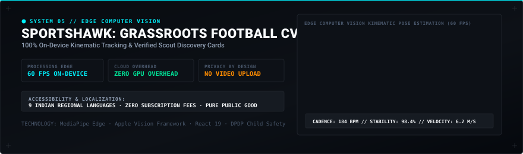
</div>

<br />

Democratizing athletic talent development across India. Allows young footballers to record agility drills with any budget smartphone, receive instant on-device computer vision performance scoring, and generate verified Player Cards for scout discovery.

- **100% On-Device Pose Kinematics:** ML Kit and Apple Vision pose detection tracking balance, stance, and rep cadence at 60 FPS on budget mobile hardware.
- **Zero Cloud GPU Overhead:** Video never leaves the phone; scoring and cadence extraction happen entirely at the edge without cloud processing expenses.
- **Verified Player Cards:** FIFA-style digital player identity tracking genuine athletic rep history for scouts and grassroots academies.
- **Child Safety by Construction:** DPDP child protection compliance—minor-safe views show handle and age bands only; zero video upload, zero advertising, zero behavioral profiling.
- **Grassroots Accessibility:** Zero subscription fees, zero advertising bloat, and full native localization across 9 Indian languages.

```text
┌──────────────────────┬─────────────────────────────────────────────────────────────────┐
│ SPECIFICATION        │ TECHNICAL RECORD                                                │
├──────────────────────┼─────────────────────────────────────────────────────────────────┤
│ Core Toolchain       │ React 19 · MediaPipe / TensorFlow.js · Edge Pose Kinematics     │
│ Edge Processing      │ 100% on-device CV inference at 60 FPS; zero video upload egress │
│ Data Privacy         │ DPDP child-safety compliant; age-bracketed anonymized scouting  │
│ Language Support     │ 9 Indian vernacular languages (English & Hindi live)            │
│ Commercial Ethics    │ Zero user fees · Zero advertising · 100% public good initiative │
└──────────────────────┴─────────────────────────────────────────────────────────────────┘
```

<div align="center">
  
</div>

<a id="systems-topology"></a>
## Chapter 03 // Systems Topology & Product Constellation

The systems engineered across XolverLabs are not disconnected projects; they form an interconnected technical matrix sharing common invariants of **concurrency, zero-egress sandboxing, and deterministic state transitions**:

<div align="center">
  <a href="#systems-topology">
    
  </a>
</div>

<br />

### Architectural Interconnects & Data Busses

| Interconnecting Bus | Originating Nodes | Receiving Systems | Architectural Transport & Invariants |
| :--- | :--- | :--- | :--- |
| **01 // Zero-Egress Sandbox Bus** | `OctaPDF` · `LawFlow` | `Local Host Runtime` | Air-gapped containers (`internal: true`), read-only root filesystems, zero external DNS queries, zero tracking telemetry. |
| **02 // High-Throughput Packet Bus** | `BMD` · `Formspear` | `Tokio & Node NIO Channels` | Segmented HTTP Range byte streams, lock-free circular ring buffers, single-writer advisory locks, p99 < 15ms. |
| **03 // Vernacular Cognitive Bus** | `Vaani` · `Speak-It` | `Telephony & Input Hooks` | Sub-3s voice synthesis, LangGraph 7-node state machines, tenant-grounded vector indexes, offline whisper.cpp fallback. |
| **04 // Cryptographic Ledger Bus** | `Settlr` · `XenAlgo` | `Postgres & SQLite Journals` | SHA-256 chained append-only ledgers, mutual dual-consent signatures, replayable event logs, broker risk veto. |
| **05 // Tactile Interface Bus** | `LivelyUI` · `candy-drop` | `Browser & Desktop Shells` | 60 FPS pure Canvas 2D loops, procedural Web Audio chips, concentric radii, interruptible spring physics curves. |

<div align="center">
  
</div>

<a id="advanced-systems"></a>
## Chapter 04 // Advanced Systems & LegalTech Wing

Specialized institutional operating systems engineered for regulatory compliance, financial arbitration, and headless event automation:

### 01 // LawFlow — Practice Operating System for Indian Court Advocates
**Stack:** Rust (`backend-rs` on Axum 0.7) · SQLx · Tauri 2 · Expo React Native · Offline-First SQLite  
**Domain:** Judicial Chambers Automation · LegalTech · Bharatiya Sakshya Adhiniyam 2023  
- **Rust Server Core:** Built on Axum 0.7 and SQLx connection pools with Tokio async runtime, delivering sub-2ms response latencies for high-frequency chamber case queries.
- **Chambers Desktop & Mobile Duality:** Tauri 2 native desktop application for advocate chambers paired with an offline-first Expo React Native mobile client for court corridors.
- **Zero-Leakage Tenancy:** Strict isolation preventing cross-tenant document exposure, backed by single-case time-expiring tokenized client outcome portals.
- **Statutory Alignment:** Codified specifically for the **Bharatiya Sakshya Adhiniyam 2023**, Advocates Act 1961, and Bar Council of India Rule 36 non-solicitation rules.
- **Sovereign Color System:** Sage & Champagne Gold (`#C9A84C`, `#080A09`, `#E2E8E4`) engineered specifically for legibility under intense courtroom lighting.

---

### 02 // FireBNB — High-Frequency Travel Arbitration Engine
**Stack:** Flutter 3.44+ · Next.js 16 Ops Desk · Deno Edge Functions · Upstash Redis · Supabase  
**Domain:** Dynamic Market Arbitration · Inventory Scraping Optimization  
- **In-Memory MAR Cache:** Upstash Redis cache pre-warmed with Market Average Rates (MAR), reducing initial hotel search latency to `<50ms` (down from 30–45s legacy scraping delays).
- **15-Minute Deal Chronometer:** Server-authoritative negotiation countdown (`expires_at = now() + 15m`) arbitrating exclusive wholesale supplier rates up to 40% below retail pricing.
- **Zero Float Custody:** Direct API settlement with zero supplier cash holding; fail-closed refund triggers on expired arbitration windows.

---

### 03 // EventX (Occasions) — Headless Date-Driven Micro-SaaS Engine
**Stack:** Next.js 16 (OpenNext Cloudflare Workers) · Supabase PostgreSQL · `pg_cron` · `pgmq`  
**Domain:** Event Automation · Headless Date Routing · Idempotent Dispatch  
- **The Engine Axiom:** *"Packs seed rows into definition tables; they never add tables."* A single multi-tenant schema core powers infinite vertical event packs without DDL churn.
- **Edge Architecture:** Built on OpenNext for Cloudflare Workers, using `proxy.ts` for Supabase SSR session synchronization at global edge points.
- **No-Miss Scheduler:** Supabase `pg_cron` paired with `pgmq` queues executing signed ISO-8601 interval offsets (`-P7D`, `-P1D`, `P0D`, `+P3D`) with idempotent dispatch logging.

<div align="center">
  
</div>

<a id="experimental-lab"></a>
## Chapter 05 // Algorithmic Engines & Experimental Laboratory

Open-source tools, agent skills, algorithmic trading engines, and digital experiments engineered for the software craft community:

---

### 01 // XenAlgo — Autonomous NSE Swing Trading Execution System
**Repository:** [`github.com/DecoyINDIA/XenAlgo`](https://github.com/DecoyINDIA/XenAlgo) &bull; **Stack:** Python 3.12 · Fyers API v3 · SQLite Journal

<div align="center">
  <a href="https://github.com/DecoyINDIA/XenAlgo">
    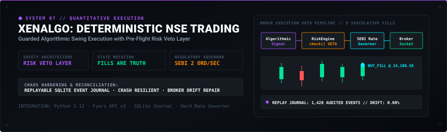
  </a>
</div>

<br />

An autonomous swing-trading execution system engineered for Indian equity markets (NSE) on a single Fyers broker account.
- **Risk as Veto Layer:** Every trade intent must pass `RiskEngine.check()` (capital allocation, daily loss ceiling, volatility gates) before reaching broker sockets.
- **Confirmed Fills as Sole Truth:** Portfolio positions mutate strictly upon verified broker fill receipts—never upon order submission.
- **Append-Only Replay Journal:** System state is completely derived from an immutable SQLite event ledger capable of deterministic historical replay.
- **SEBI Rate Governor:** Hard-capped at 2 orders/second to eliminate algorithmic penalties and broker rate-limit disconnects.

---

### 02 // AI_Jantra — Deterministic Planning Agent Runtime
**Repository:** [`github.com/DecoyINDIA/AI_Jantra`](https://github.com/DecoyINDIA/AI_Jantra) &bull; **Stack:** TypeScript · Fastify · MockProvider

An autonomous product planning and engineering specification pipeline that generates production-grade PRDs, TRDs, and executable build schedules.
- **Deterministic Citation Grounding (`citationVerifier.ts`):** Regex scans raw 400-character source text windows; unproven or hallucinated claims are systematically purged.
- **Generator ≠ Critic Architecture:** Dual-pass rubric evaluation ensures no stage can accept its own unverified first draft.
- **Fail-Closed Security:** Prompt injection filters and network guards (`netGuard.ts`) preventing SSRF and private intranet IP leakage.
- **100% Offline Verifiability:** 20 regression tests running against a deterministic `MockProvider` with zero network access and zero token cost.

---

### 03 // Candy Arcade (`candy-drop`) — 100 Zero-Dependency Browser Games
**Repository:** [`github.com/DecoyINDIA/candy-drop`](https://github.com/DecoyINDIA/candy-drop) &bull; **Stack:** HTML5 Canvas 2D · Web Audio API · Vanilla JS

<div align="center">
  <a href="https://github.com/DecoyINDIA/candy-drop">
    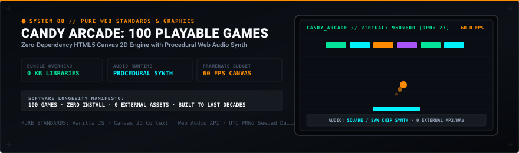
  </a>
</div>

<br />

A pure web standards manifesto: **100 Original Playable Games · 0 KB Dependencies · 0 Install · 60 FPS Pure Canvas.**
- **Pure Canvas 2D Rendering:** Zero frameworks, zero external image files, and zero runtime dependencies; engineered to run offline and remain playable decades into the future.
- **Procedural Sound Synthesizers:** All audio effects (combos, drops, power-ups, game-over chimes) generated in real-time via the procedural Web Audio API.
- **Fixed Virtual Resolution:** 960×600 virtual coordinate space with crisp integer device-pixel-ratio (DPR) scaling across mobile, tablet, and 4K displays.
- **Deterministic Seeded Challenges:** Daily challenges generated via a UTC midnight pseudo-random number generator (PRNG) ensuring identical runs across all players globally.

---

### 04 // SantianoFX (KineticFlow AE) — Motion Easing Panel for After Effects
**Repository:** [`github.com/DecoyINDIA/SantianoFX`](https://github.com/DecoyINDIA/SantianoFX) &bull; **Stack:** React · TypeScript · Vite · Adobe CEP 11 · ExtendScript  
A professional post-production motion design panel for Adobe After Effects 2024+. Features preset-driven speed ramps, temporal bezier easing graphs, physics-based camera shake with exponential decay, 12-look `.cube` LUT color library, and beat-synced BPM keyframe markers.

---

### 05 // Speak-It — System-Wide Voice Typing for Windows with Hinglish NLU
**Repository:** [`github.com/DecoyINDIA/Speak-It`](https://github.com/DecoyINDIA/Speak-It) &bull; **Stack:** Electron · React 19 · C# .NET 4.8 · whisper.cpp  
System-wide push-to-talk voice dictation (<kbd>Ctrl</kbd> + <kbd>Win</kbd>) engineered for Indian multilingual workflows. Features sub-second Groq LPU cloud transcription alongside a bundled offline `whisper.cpp` fallback, conversational filler stripping, DPAPI credential encryption, and a Windows UI Automation password shield.

---

### 06 // AI-Websites-Cloner — Multi-Agent Web Reverse-Engineering
**Repository:** [`github.com/DecoyINDIA/AI-Websites-Cloner`](https://github.com/DecoyINDIA/AI-Websites-Cloner) &bull; **Stack:** Next.js 16 · Tailwind CSS v4 · Git Worktrees  
An autonomous multi-agent pipeline that inspects, decomposes, and reconstructs complex web interfaces into clean Next.js 16 codebases. Coordinates parallel AI agents in isolated git worktrees, extracting exact computed CSS style metrics (`getComputedStyle()`) and asset hierarchies.

---

### 07 // iADHD & LivelyUI — Cognitive & Interaction Engineering Skills
- **[`iADHD`](https://github.com/DecoyINDIA/iADHD):** A high-signal cognitive adapter skill for AI coding agents. Enforces 10 non-negotiable communication rules: strips conversational fluff, leads immediately with file paths, numbers multi-step tasks, and delivers bottom-line diffs.
- **[`LivelyUI`](https://github.com/DecoyINDIA/LivelyUI):** An interaction physics skill translating the foundational principles of tactile software into reusable spring dynamic curves, concentric border radii ($R_{outer} = R_{inner} + \text{padding}$), interruptible CSS transitions, and optical alignment rules.

---

### 08 // Lekha — Sovereign Local-First Markdown Notebook (Roadmap)
Subham's ongoing architectural investigation into an air-gapped, local-first personal knowledge workspace, extending the zero-egress invariants and Project Loom virtual thread mechanics proven in OctaPDF to document graph indexing and bi-directional linking.

<div align="center">
  
</div>

<a id="engineering-disciplines"></a>
## Chapter 06 // Engineering Disciplines & Specialization Matrix

Our technical capabilities span five disciplined architectural layers:

| Layer | Specialization Discipline | Primary Production Toolchains | Key Production Invariants & Guarantees |
| :---: | :--- | :--- | :--- |
| **01** | **Bare-Metal Systems &amp; Concurrency** | `Rust` · `Tokio` · `Java 21 (Loom)` · `Axum` · `C# .NET` · `C/C++` | Dynamic byte chunking, lock-free ring buffers, virtual thread non-blocking I/O, predictable p99 tail-latency < 15ms. |
| **02** | **Sovereign Privacy &amp; Zero Egress** | `Docker (internal: true)` · `DPDP Act 2025` · `whisper.cpp` · `MediaPipe Edge` | Zero third-party phone-home telemetry, read-only root filesystems, air-gapped on-premise inference, 7-day automated erasure. |
| **03** | **Vernacular AI &amp; Grounded Agents** | `LangGraph` · `Python 3.12` · `FastAPI` · `Atlas Vector` · `Groq LPU` | 7-node scoped state machines, regex source window verification, zero-hallucination abstention, Indic speech synthesis. |
| **04** | **Cryptographic Trust &amp; Relational Rigor** | `PostgreSQL 15` · `Supabase` · `MongoDB 7+ Replica` · `Redis` · `BullMQ` | SHA-256 chained append-only ledgers, 39-table SQL baselines with 13 indexes, advisory locks, 100k synthetic load certification. |
| **05** | **Tactile Interfaces &amp; Interaction Physics** | `Next.js 16` · `Flutter 3.44` · `Canvas 2D` · `Web Audio` · `Adobe CEP 11` | 60 FPS pure Canvas game loops, procedural audio chips, LivelyUI spring dynamics, concentric radii, sub-frame input responsiveness. |

<div align="center">
  
</div>

<a id="operational-tenets"></a>
## Chapter 07 // Deterministic Operational Tenets

Six non-negotiable engineering principles governing every system engineered across XolverLabs:

```text
 01. DETERMINISTIC LATENCY OVER PROBABILISTIC NOVELTY
     Every software system must have well-defined latency boundaries, predictable state machines,
     and fail-closed invariants. Code that cannot be reasoned about under catastrophic failure is broken by definition.

 02. SOVEREIGNTY BY DESIGN (ZERO OUTBOUND EGRESS)
     User data belongs exclusively to the user. Default to local-first execution. Production containers
     must run with read-only root filesystems and disabled network egress (internal: true). Third-party telemetry pixels are toxic.

 03. VERNACULAR-FIRST HUMAN DIGNITY
     High technology in the Global South cannot exist solely behind English academic walls. Software systems
     must converse fluently in Hindi, Odia, and regional tongues with zero hallucinations and radical respect for human intent.

 04. CRYPTOGRAPHIC PROOF OVER INSTITUTIONAL GOOD FAITH
     Eliminate subjective dispute and broker fraud with mathematical verification: SHA-256 chained ledgers,
     mutual cryptographic co-signatures, and government municipal registry qualification moats.

 05. RELATIONAL SCHEMAS OVER NOSQL LAZINESS
     Schema-less flexibility is often an excuse for undisciplined architecture. Complex domain entities require
     strict relational normalization, foreign-key integrity constraints, and advisory locks before data hits disk.

 06. TACTILE CRAFT AS FUNCTIONAL CLARITY
     Interfaces are not superficial varnish; they are the contract between human cognition and machine logic.
     Spring physics, intentional contrast, and micro-feedback reduce user error and dignify everyday labor.
```

<div align="center">
  
</div>

<a id="direct-transmission"></a>
## Epilogue // Direct Transmission Console & Terminal

Open for architectural consulting on high-throughput distributed systems, low-latency concurrency engines in Rust/Java, and strategic enterprise AI agent deployments:

```text
┌────────────────────────────────────────────────────────────────────────────────────────┐
│ DIRECT TRANSMISSION CHANNELS // SECURE FREQUENCIES                                    │
├─────────────────────┬──────────────────────────────────────────────────────────────────┤
│ PRIMARY STUDIO      │ XolverLabs · Engineering Atelier (https://xolver.in)             │
│ DIRECT INBOX        │ lawflow.india@gmail.com                                          │
│ FOUNDER DIRECT      │ subhamjena.j@gmail.com                                           │
│ GITHUB PROTOCOL     │ https://github.com/DecoyINDIA                                    │
│ LOCATION FREQUENCY  │ Bhubaneswar, Odisha, India · Coordinates: 20.2961° N, 85.8245° E │
│ ENGAGEMENT STATUS   │ Available for High-Throughput Rust/Java R&D, Agentic AI Systems │
└─────────────────────┴──────────────────────────────────────────────────────────────────┘
```

<br />

<div align="center">
  <a href="mailto:subhamjena.j@gmail.com"><code>TRANSMIT DISPATCH &rarr; subhamjena.j@gmail.com</code></a> &nbsp;&bull;&nbsp;
  <a href="mailto:lawflow.india@gmail.com"><code>STUDIO INBOX &rarr; lawflow.india@gmail.com</code></a> &nbsp;&bull;&nbsp;
  <a href="https://github.com/DecoyINDIA"><code>GITHUB PROTOCOL &rarr; @DecoyINDIA</code></a> &nbsp;&bull;&nbsp;
  <a href="https://xolver.in"><code>XOLVERLABS ATELIER &rarr; xolver.in</code></a>
</div>

<br />

<div align="center">
  <a href="#prologue">
    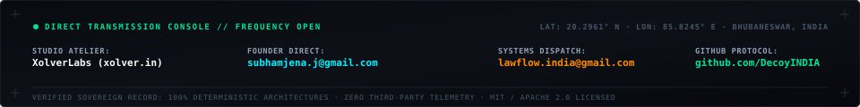
  </a>
</div>
